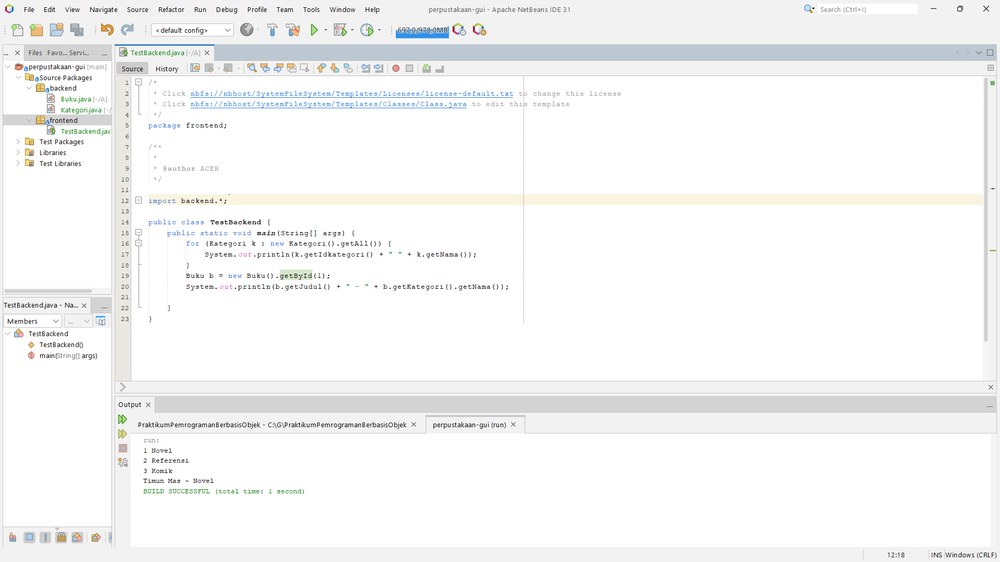
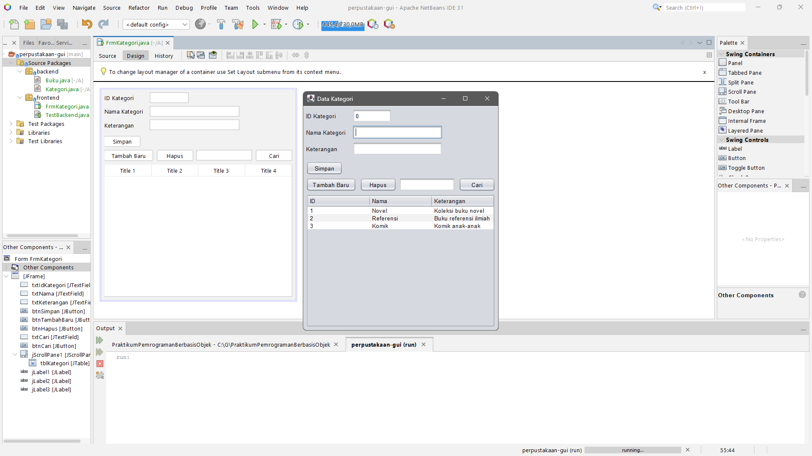
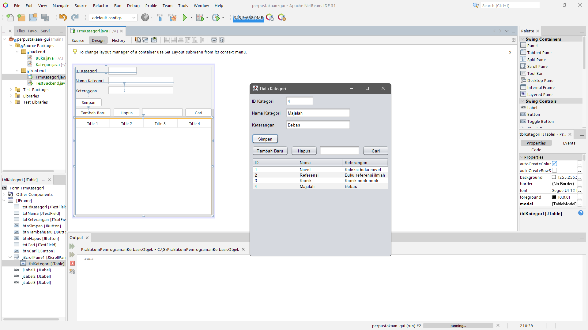
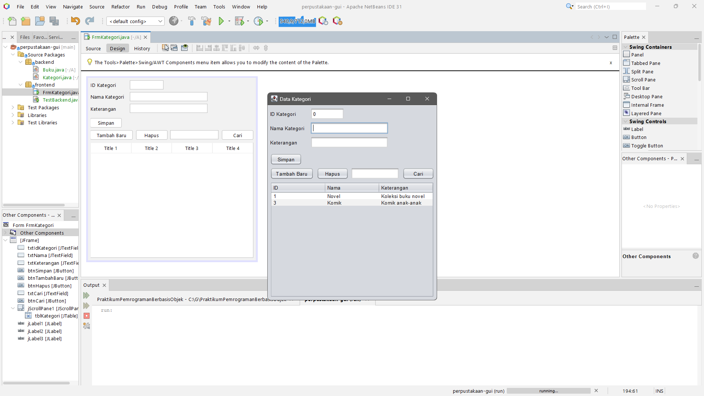
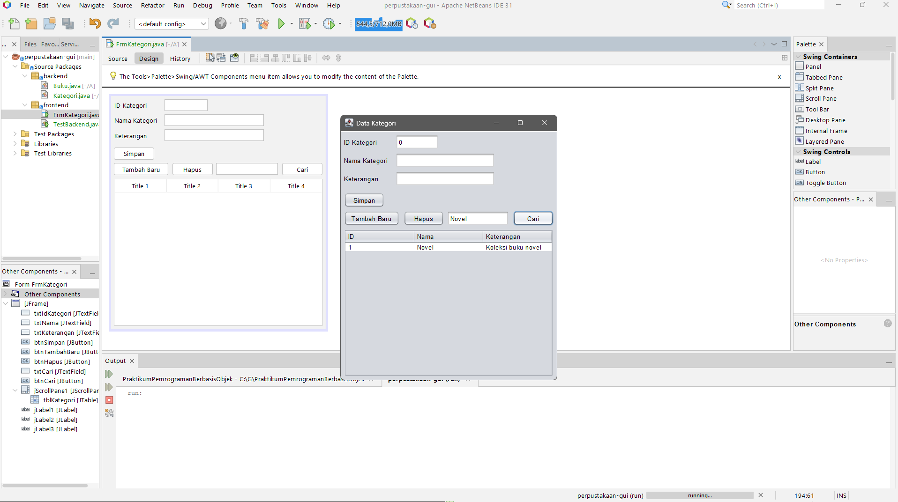
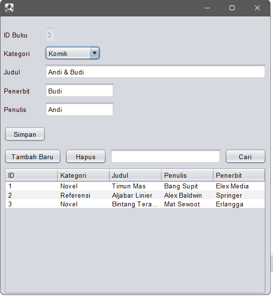
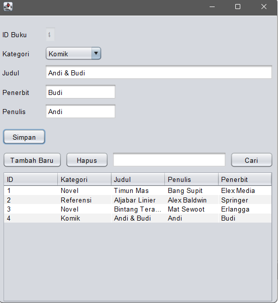

|            | Praktikum Pemrograman Berbasis Objek                                                        |
| ---------- | ------------------------------------------------------------------------------------------- |
| NIM        | 254107020130                                                                                |
| Nama       | Achmad Pradita Dwi Firmansyah                                                               |
| Kelas      | TI - 2G                                                                                     |
| Repository | [link](https://github.com/praditadf/PraktikumPemrogramanBerbasisObjek/tree/main/jobsheet12) |

## Langkah 1: Proyek, Backend, dan Pemisahan Frontend-Backend



## Langkah 2: Merancang Form dengan Matisse (FrmKategori)


## Langkah 3: Menampilkan Data ke JTable



## Langkah 4: Event Handling Pertama (Simpan dan Tambah Baru)




## Langkah 5: Event Mouse, Hapus, dan Cari






# Tugas dan Hasil Kerja





## Jawab secara singkat (2-3 kalimat untuk masing-masing pertanyaan):

- (a) Jelaskan perbedaan event source, listener, dan handler dengan contoh dari tombol Simpan. Mengapa blok initComponents() tidak boleh diedit?

```
Event source adalah btnSimpan (komponen yang diklik). Listener adalah objek ActionListener yang didaftarkan ke tombol lewat addActionListener. Handler adalah method btnSimpanActionPerformed yang dipanggil saat tombol diklik. initComponents() tidak boleh diedit karena dibuat otomatis oleh Matisse dan akan ditimpa ulang saat desain berubah, sehingga editan manual hilang atau merusak sinkronisasi desain dan kode.
```

- (b) Mengapa setelah save() kode memanggil tampilkanData() dan tidak menambah baris ke tabel secara langsung?

```
Backend adalah satu-satunya sumber data, tabel hanya tampilannya. Memuat ulang lewat tampilkanData() menjamin isi tabel sama dengan data sebenarnya, termasuk id baru dan hasil ubah. Menambah baris manual berisiko tabel dan backend tidak sinkron.
```

- (c) Pertemuan berikutnya data diganti dari memori ke database. Bagian mana dari form yang perlu diubah, dan mengapa?

```
Yang diubah hanya implementasi backend (getAll, save, delete, search, getById diganti query database). Form tidak perlu berubah karena hanya memanggil method dan tidak tahu cara data disimpan (Single Responsibility, loose coupling).
```
