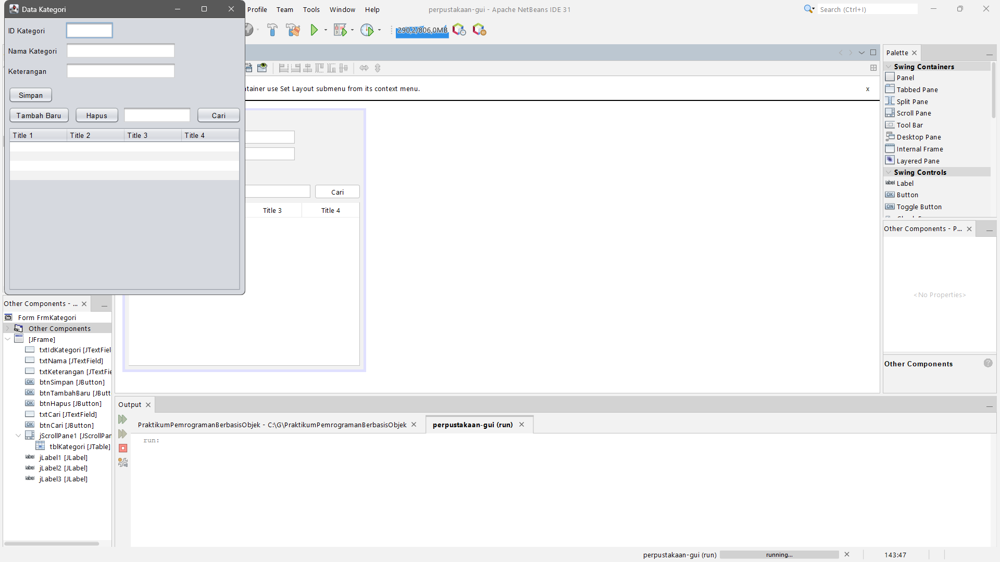
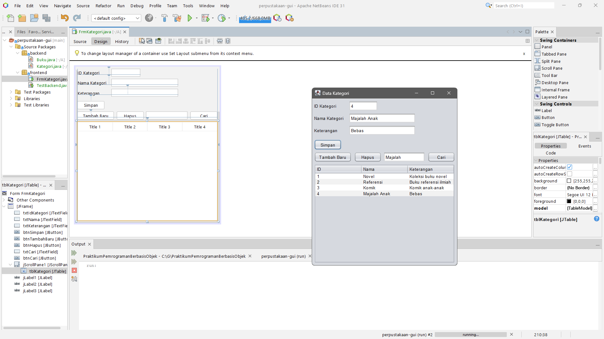
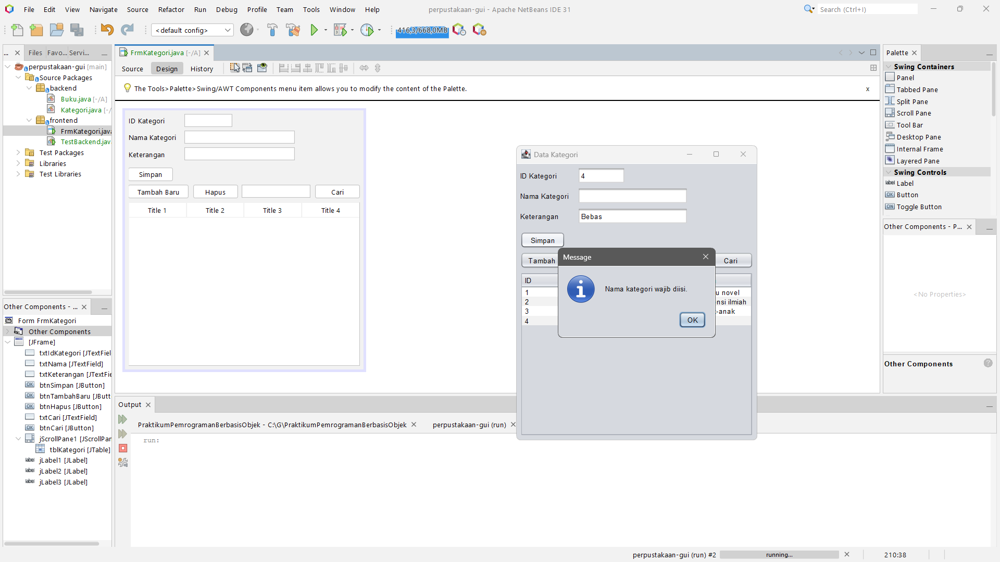
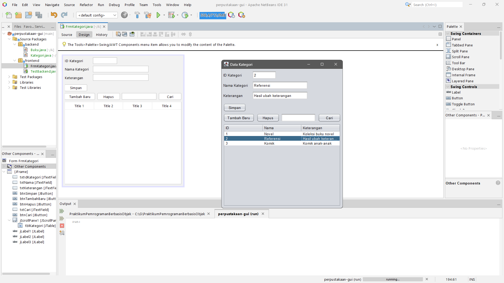
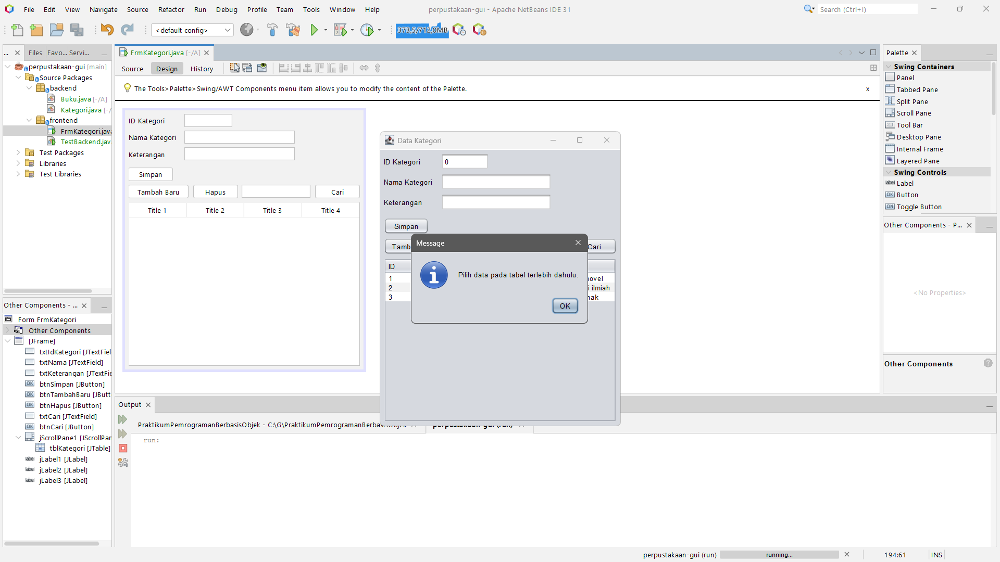

|            | Praktikum Pemrograman Berbasis Objek                                                        |
| ---------- | ------------------------------------------------------------------------------------------- |
| NIM        | 254107020130                                                                                |
| Nama       | Achmad Pradita Dwi Firmansyah                                                               |
| Kelas      | TI - 2G                                                                                     |
| Repository | [link](https://github.com/praditadf/PraktikumPemrogramanBerbasisObjek/tree/main/jobsheet12) |

## Langkah 1: Proyek, Backend, dan Pemisahan Frontend-Backend

## Langkah 2: Merancang Form dengan Matisse (FrmKategori)

## Langkah 3: Menampilkan Data ke JTable

## Langkah 4: Event Handling Pertama (Simpan dan Tambah Baru)

## Langkah 5: Event Mouse, Hapus, dan Cari

