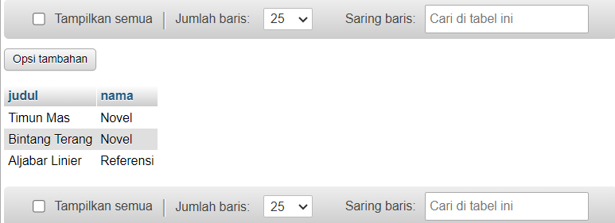
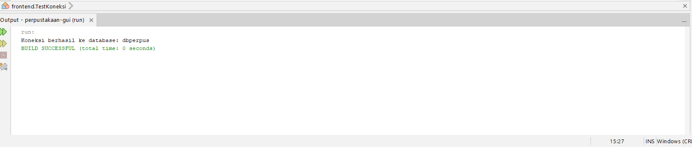
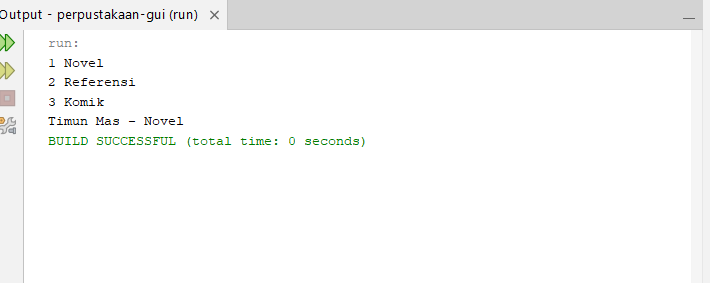
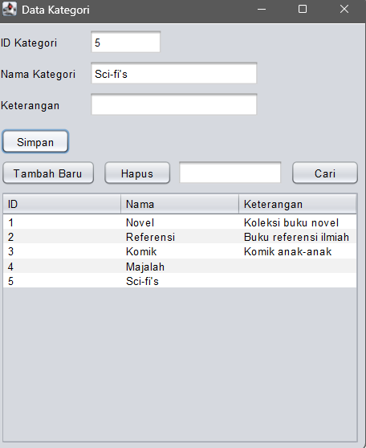
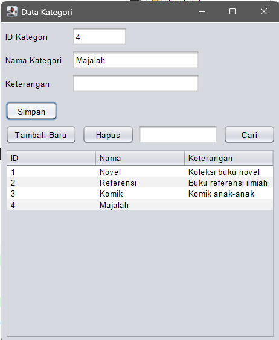
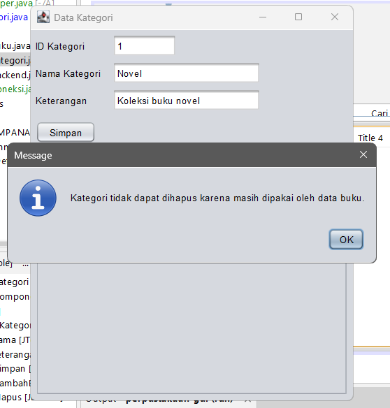
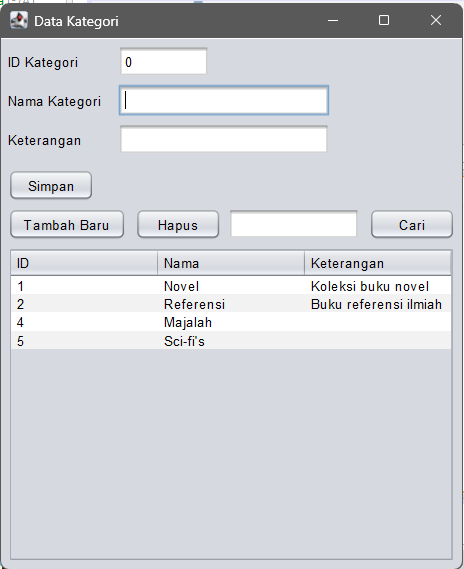

|            | Praktikum Pemrograman Berbasis Objek                                                        |
| ---------- | ------------------------------------------------------------------------------------------- |
| NIM        | 254107020130                                                                                |
| Nama       | Achmad Pradita Dwi Firmansyah                                                               |
| Kelas      | TI - 2G                                                                                     |
| Repository | [link](https://github.com/praditadf/PraktikumPemrogramanBerbasisObjek/tree/main/jobsheet13) |

## Langkah 1: Membuat Database dan Tabel

## Langkah 2: Menghubungkan Java ke MySQL (JDBC)

## Langkah 3: Membaca Data (getAll, getById, search)

## Langkah 4: Menulis Data (save dan delete)

## Langkah 5: Menangani Error Database di GUI

### Hapus novel

### Hapus komik

# Tugas dan Hasil Kerja

## Jawab secara singkat (2-3 kalimat untuk masing-masing pertanyaan):

- (a) Jelaskan mengapa query ditulis dengan ? pada PreparedStatement, dan apa yang akan terjadi pada Sci-fi's bila SQL dirakit dengan penyambungan teks.
- (b) FrmKategori hampir tidak berubah saat backend pindah dari memori ke database. Konsep OOP apa yang memungkinkan hal ini, dan di bagian kode mana kontraknya ditulis?
- (c) DBHelper.getConnection() membuka koneksi baru untuk setiap operasi. Sebutkan satu kelebihan dan satu kekurangan pendekatan ini.
